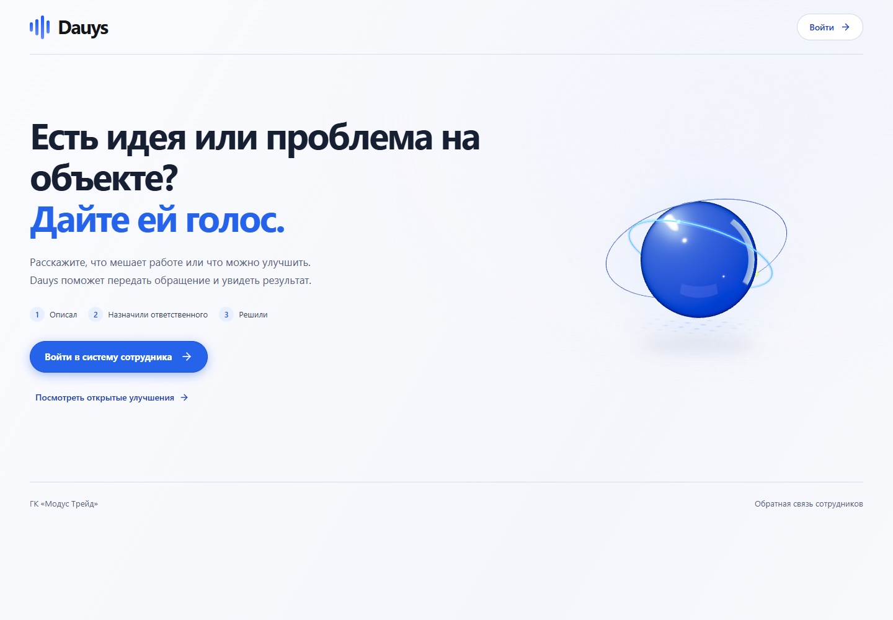

# Dauys — обратная связь, которая доходит до результата

[](https://github.com/www60549-dotcom/dauys-hackathon/actions/workflows/ci.yml)

Сотрудник сообщает о проблеме → исполнитель уточняет и проверяет изменение →
автор подтверждает результат. Полный цикл работает через Go API и PostgreSQL.

**Для жюри:** [обзор продукта и сценарий проверки](docs/JURY.md) ·
[запуск и деплой](docs/DEPLOYMENT.md) · [отчёт о проверках](docs/VERIFICATION-RELEASE.md).



Система обращений сотрудников ГК «Модус Трейд». Основная папка проекта — текущая.
React/TypeScript/Vite находятся в корне, Go/Fiber/pgx/sqlc — в backend/.

## Локальный запуск на этом компьютере

В терминале VS Code из папки проекта:

```powershell
./start-local.ps1
```

Сайт: http://127.0.0.1:5175. React обращается к Go только через /api proxy.
Остановка приложения: `./stop-local.ps1`. Общий PostgreSQL остаётся запущенным.

На этом ПК путь подготовленных Go/PostgreSQL задан в игнорируемом
`data/local-config.json`. Для другого компьютера нужны Node 22.12+ (проверяется
на Node 24), Go 1.24+ и PostgreSQL 17; передайте `-DatabaseUrl` и при необходимости
`-RuntimePath`. Существующий кластер скрипт не создаёт и не переносит.

Запуск с другого устройства в своей сети: `./start-local.ps1 -Lan`.
Телефон открывает LAN-адрес компьютера, а не localhost/127.0.0.1.
Доступ зависит от Wi-Fi и правил Windows Firewall; реальный телефон ещё не проверен.

Для подготовленных демонстрационных данных: employee@dauys.local,
executor@dauys.local, admin@dauys.local; пароль `DauysDemo2026!`.
Это только локальный demo seed. В production DEMO_MODE должен быть отключён,
учётные записи создаются отдельной процедурой bootstrap.

## Что уже подключено

Реальные серверные сессии; восстановление входа; профиль из /api/me;
серверные поиск/фильтры/пагинация; карточки и создание обращений;
редактирование автором; обсуждение; вложения; назначенные исполнителю обращения;
изменение статуса/ответственного/срока/решения; подтверждение автором;
голосование за идеи; настройка маршрутизации администратором;
серверные агрегаты аналитики; SSE-инвалидация кеша; прямые ссылки на карточки.

Изменения защищены версией обращения. При конфликте форма сохраняет правки и
показывает сравнение; актуальная версия загружается явным действием пользователя.
Новые события истории содержат автора, переход статуса и версию. Автор может
вернуть решённое обращение в работу, указав причину повторения проблемы.

В карточке подключены месячная цена ожидания и полный цикл пилота с измерением
результата. При создании и просмотре работают реальные похожие обращения.
Формы модулей защищены версиями; расчётные оценки отделены от подтверждённого эффекта.
Срок первого ответа и срок решения разделены. Напоминания исполнителю и
администраторам защищены серверным интервалом 24 часа; ожидание автора их приостанавливает.
Динамика решений строится по событиям за месяц, с календарём Asia/Qyzylorda.
Для уже работающего сервера требуется перезапуск после обновления исходников;
состояние последней проверки описано в docs/VERIFICATION-BUSINESS.md.

Планета, частицы, анимации и минимальный вход сохранены. Все рабочие данные
берутся из PostgreSQL. localStorage-обращения автоматически не импортируются.

Полный production-переход ещё не завершён: идемпотентность создания и голосования,
корпоративная иерархия эскалации и расширенная аналитика,
постоянный общий Canvas, Docker/TLS/backup и окончательный браузерный E2E.

## Проверки

На подготовленном Windows-компьютере полный автоматический прогон:

```powershell
npm run verify:local
```

Команда собирает приложение, создаёт отдельную копию PostgreSQL, проверяет API и
браузерный цикл сотрудника/исполнителя, вложение и мобильный QR. Рабочие обращения
не изменяются. Итог: `data/verification-latest.json`; логи и снимок БД — в
`data/verification/<дата>/`, screenshots — в `output/playwright/<дата>/`.
При успехе собственная тестовая БД удаляется; при ошибке сохраняется для диагностики.
Требуются подготовленные Go/PostgreSQL и Chromium Playwright. Без браузера можно
запустить `./scripts/verify-local.ps1 -SkipBrowser` — отчёт явно отмечает этот пропуск.

```powershell
npm run check
npm test
npm run build
```

Go: `go test ./...` и `go vet ./...` из backend/.
API-проверки в tests/api/ создают записи. Запускайте их только с отдельной БД;
для integration.mjs нужны BASE_URL и DAUYS_ALLOW_TEST_WRITES=1.

Подробности: docs/INTEGRATION.md, docs/API-CONTRACT.md, docs/VERIFICATION-BUSINESS.md,
docs/acceptance.md, docs/VERIFICATION-INTEGRATION.md.
Исторические отчёты и исходное описание UI — docs/legacy/.
